# ☕ Java Samples Catalog

This directory contains the Java samples using traditional Android Views for the Android Maps 3D SDK.

## 📊 Sample Status

| Feature | Status | Source Code | Screenshot | Description |
| :--- | :--- | :--- | :--- | :--- |
| **Basic Map** | ✅ Done | [HelloMapActivity.java](src/main/java/com/example/maps3djava/hellomap/HelloMapActivity.java) | 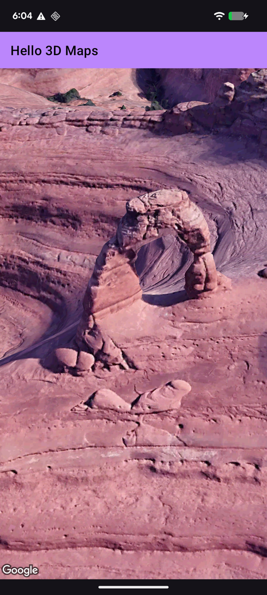 | Displays a basic 3D map with standard satellite imagery and initial camera placement. |
| **Polylines** | ✅ Done | [PolylinesActivity.java](src/main/java/com/example/maps3djava/polylines/PolylinesActivity.java) | 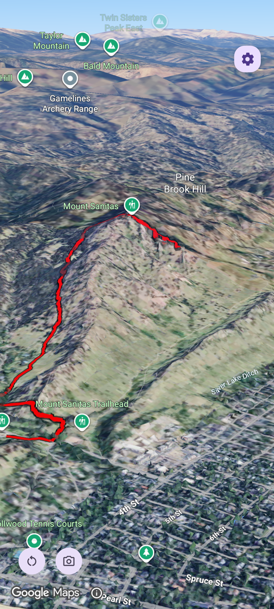 | Demonstrates drawing 3D polylines on the map, including custom colors and widths. |
| **Map Interactions** | ✅ Done | [MapInteractionsActivity.java](src/main/java/com/example/maps3djava/mapinteractions/MapInteractionsActivity.java) | 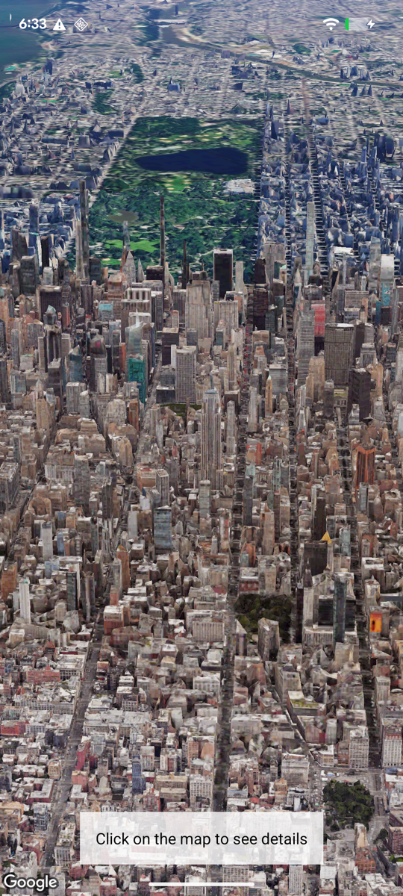 | Demonstrates handling click events on map coordinates and POIs. |
| **Popovers** | ✅ Done | [PopoversActivity.java](src/main/java/com/example/maps3djava/popovers/PopoversActivity.java) | 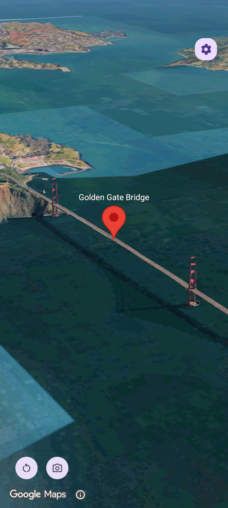 | Shows how to display interactive popover overlays at specific coordinates on the map. |
| **Camera Controls** | ✅ Done | [CameraControlsActivity.java](src/main/java/com/example/maps3djava/cameracontrols/CameraControlsActivity.java) | 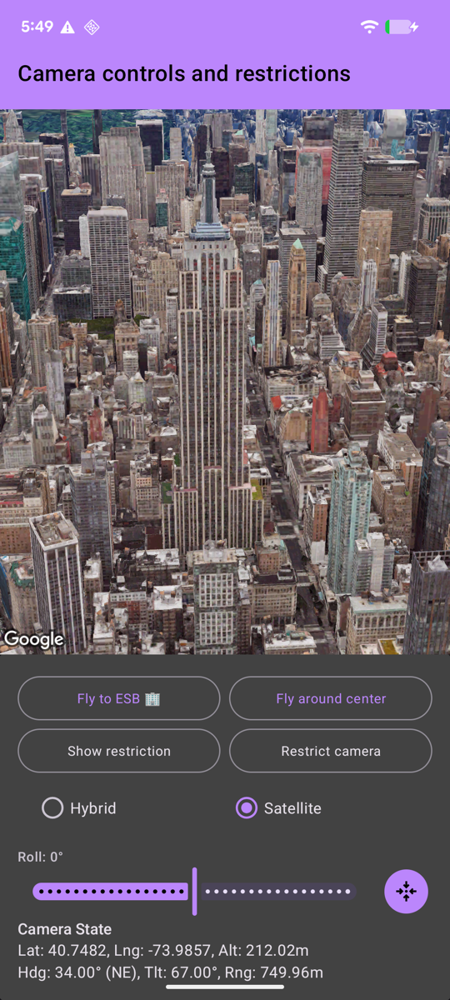 | Demonstrates manual control of the camera center, heading, tilt, and range using UI controls. |
| **Polygons** | ✅ Done | [PolygonsActivity.java](src/main/java/com/example/maps3djava/polygons/PolygonsActivity.java) | 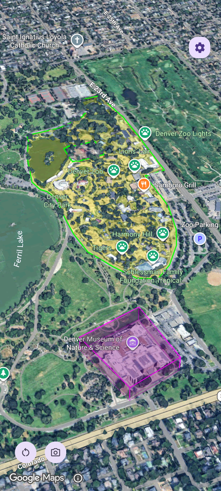 | Demonstrates drawing 3D polygons with fill colors and outlines on the map. |
| **Models** | ✅ Done | [ModelsActivity.java](src/main/java/com/example/maps3djava/models/ModelsActivity.java) | 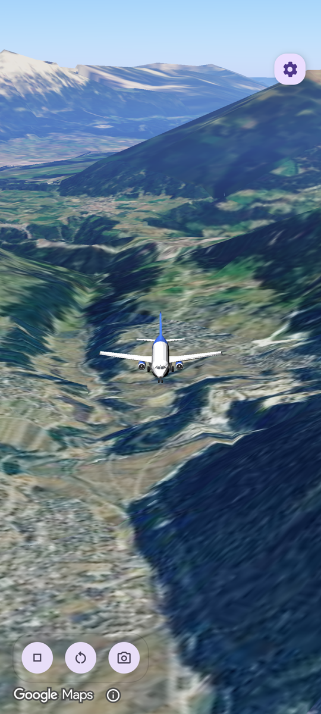 | Shows how to load and place custom 3D models (gLTF) on the map with position, scale, and orientation. |
| **Markers** | ✅ Done | [MarkersActivity.java](src/main/java/com/example/maps3djava/markers/MarkersActivity.java) | 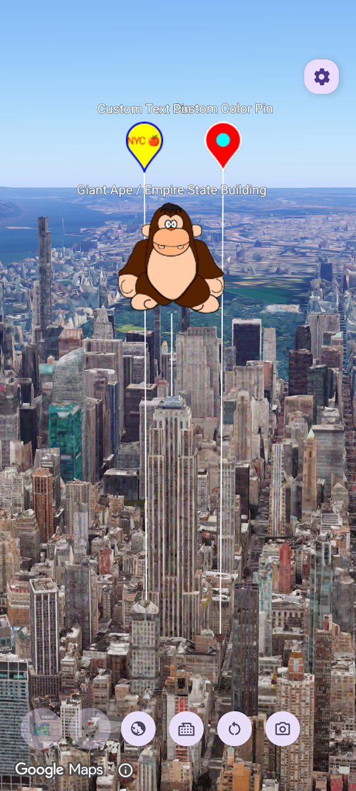 | Demonstrates 2D markers with custom icons, styled pins (pin configurations), and collision behaviors. |
| **Camera Restrictions** | 🚧 Skeleton | [CameraRestrictionsActivity.java](src/main/java/com/example/maps3djava/camerarestrictions/CameraRestrictionsActivity.java) | | Will demonstrate restricting the camera range and center bounds to a specific area. |
| **Flight Simulator** | 🚧 Skeleton | [FlightSimulatorActivity.java](src/main/java/com/example/maps3djava/flightsimulator/FlightSimulatorActivity.java) | | Will demonstrate a first-person camera view simulating flight. |
| **Routes API** | ✅ Done | [RoutesActivity.java](src/main/java/com/example/maps3djava/routes/RoutesActivity.java) | 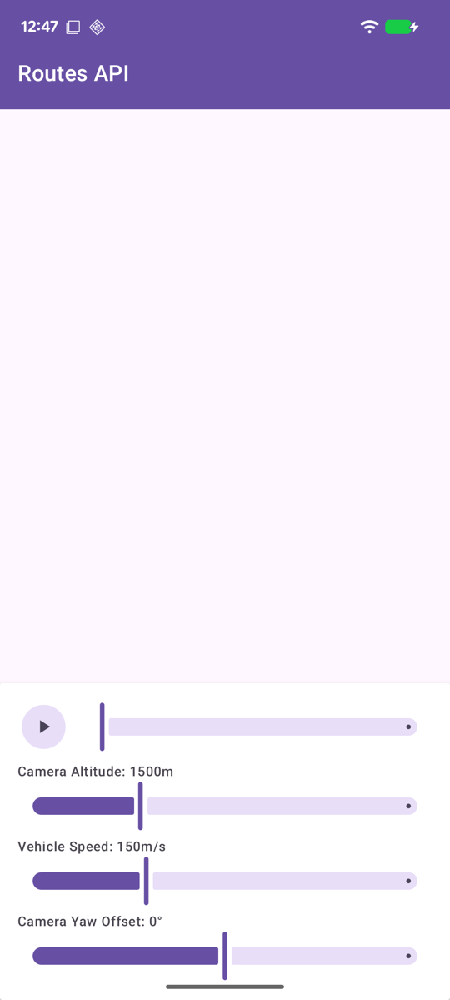 | Demonstrates loading a route from file, rendering the polyline, and animating a 3D car model along the route. |
| **Path Following** | ✅ Done | [PathFollowingActivity.java](src/main/java/com/example/maps3djava/pathfollowing/PathFollowingActivity.java) | 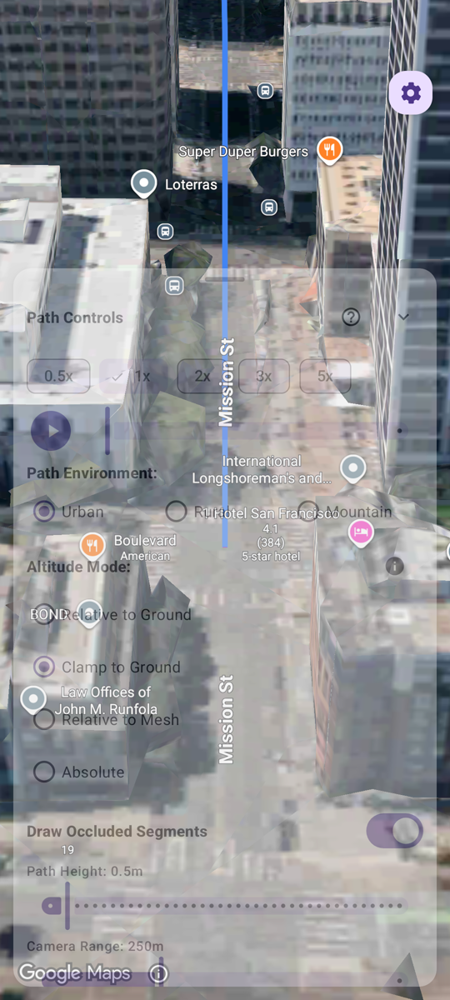 | Demonstrates camera traveling along a 3D path with dual-polyline tracking and decoupled gestures. |
| **Path Styling** | 🚧 Skeleton | [PathStylingActivity.java](src/main/java/com/example/maps3djava/pathstyling/PathStylingActivity.java) | | Will demonstrate custom styling for paths. |
| **Animating Models** | 🚧 Skeleton | [AnimatingModelsActivity.java](src/main/java/com/example/maps3djava/animatingmodels/AnimatingModelsActivity.java) | | Will demonstrate animating 3D models. |
| **Place Search** | 🚧 Skeleton | [PlaceSearchActivity.java](src/main/java/com/example/maps3djava/placesearch/PlaceSearchActivity.java) | | Will demonstrate programmatic place search (see also [PlacesUIKit3D](../../../PlacesUIKit3D/README.md)). |
| **Place Autocomplete** | 🚧 Skeleton | [PlaceAutocompleteActivity.java](src/main/java/com/example/maps3djava/placeautocomplete/PlaceAutocompleteActivity.java) | | Will demonstrate place autocomplete widget (see also [PlacesUIKit3D](../../../PlacesUIKit3D/README.md)). |
| **Place Details** | 🚧 Skeleton | [PlaceDetailsActivity.java](src/main/java/com/example/maps3djava/placedetails/PlaceDetailsActivity.java) | | Will demonstrate loading place details (see also [PlacesUIKit3D](../../../PlacesUIKit3D/README.md)). |
| **Advanced Camera Animation** | ✅ Done | [AdvancedCameraAnimationActivity.java](src/main/java/com/example/maps3djava/advancedcameraanimation/AdvancedCameraAnimationActivity.java) | 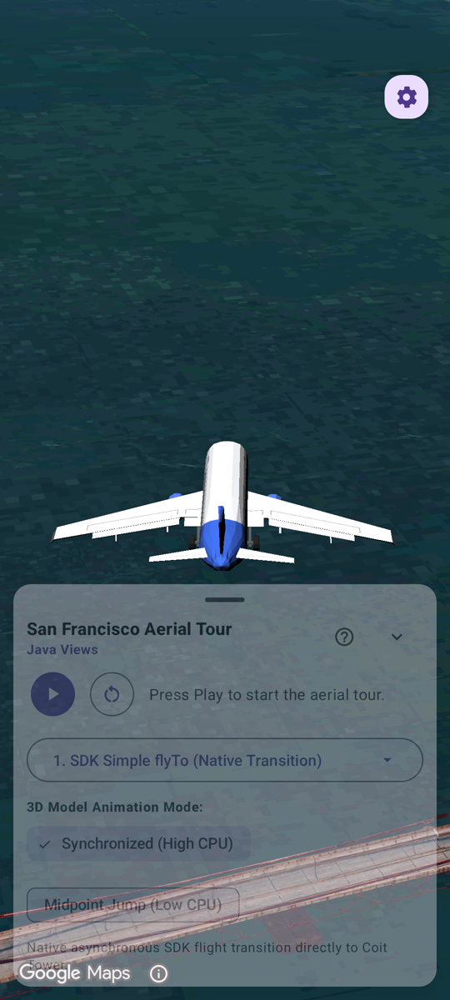 | Demonstrates reverse-trig stationary tracking, 5-step keyframe tour, and 360° orbit. |
| **Data Visualization** | ✅ Done | [DataVisualizationActivity.java](src/main/java/com/example/maps3djava/datavisualization/DataVisualizationActivity.java) | 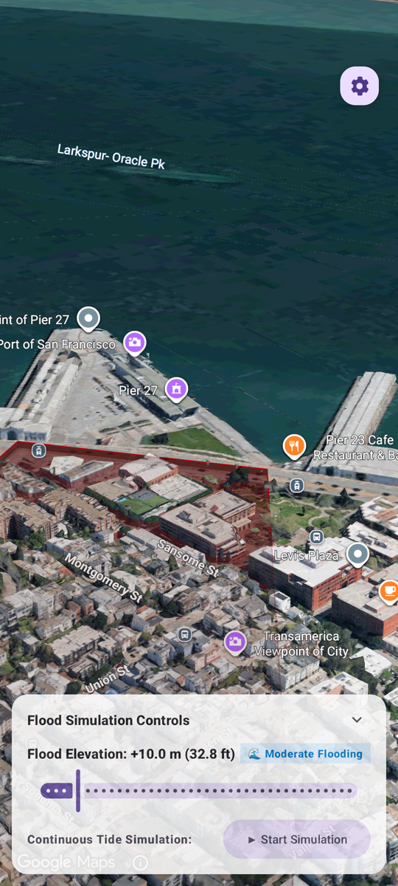 | Demonstrates 3D extruded flood simulation polygons with dynamic elevation slider. |
| **Cloud Map Styling** | ✅ Done | [CloudStylingActivity.java](src/main/java/com/example/maps3djava/cloudstyling/CloudStylingActivity.java) | 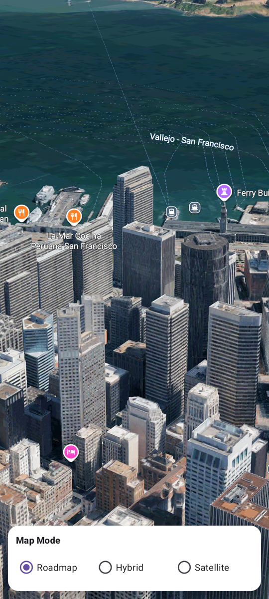 | Demonstrates dynamic Cloud Console Map ID runtime styling. |
| **Roadmap Mode** | ✅ Done | [RoadmapModeActivity.java](src/main/java/com/example/maps3djava/roadmapmode/RoadmapModeActivity.java) | 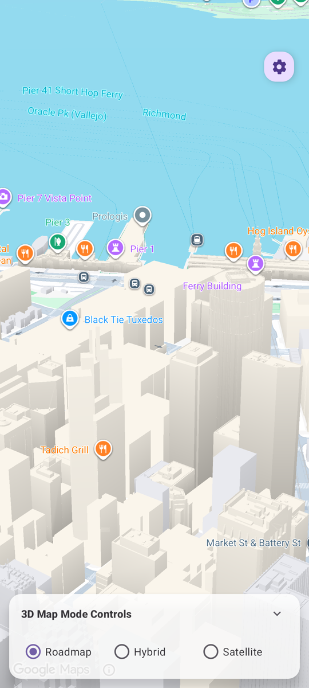 | Demonstrates 2D vector roadmap tiles overlay on 3D photorealistic mesh. |
| **UI Controls** | ✅ Done | [UiControlsActivity.java](src/main/java/com/example/maps3djava/uicontrols/UiControlsActivity.java) | 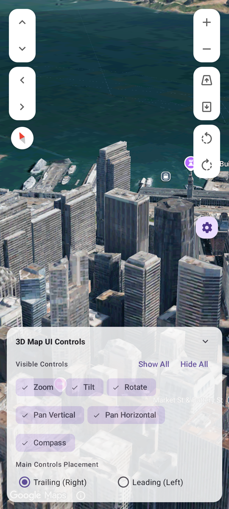 | Demonstrates toggling the built-in compass and map toolbar controls on the 3D map. |
| **Field Of View** | ✅ Done | [FieldOfViewActivity.java](src/main/java/com/example/maps3djava/fieldofview/FieldOfViewActivity.java) | 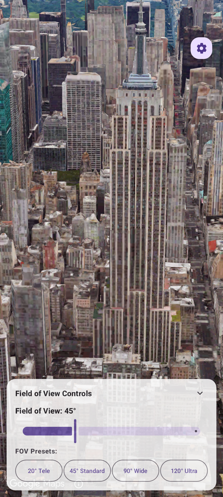 | Demonstrates interactive camera lens focal length and FOV adjustments. |
| **3D Projection** | ✅ Done | [Projection3DActivity.java](src/main/java/com/example/maps3djava/projection3d/Projection3DActivity.java) | 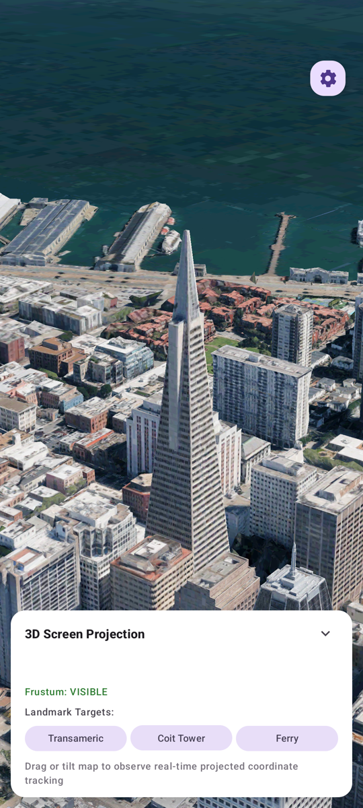 | Demonstrates projecting a 3D map coordinate onto 2D screen space to anchor custom HUD overlays. |
| **Maps Localization** | ✅ Done | [MapsLocalizationActivity.java](src/main/java/com/example/maps3djava/mapslocalization/MapsLocalizationActivity.java) | 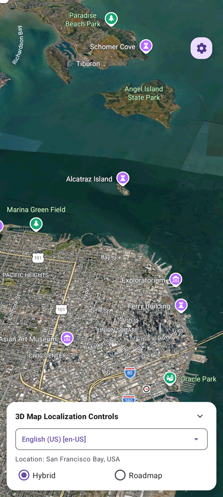 | Demonstrates runtime language and locale switching for 3D map labels using AppCompat per-app language APIs. |

---
> [!NOTE]
> These samples are view-based and serve as a reference for Java developers.
> Status `🚧 Skeleton` means the activity exists and can be launched from the main list, but contains a TODO placeholder UI.
