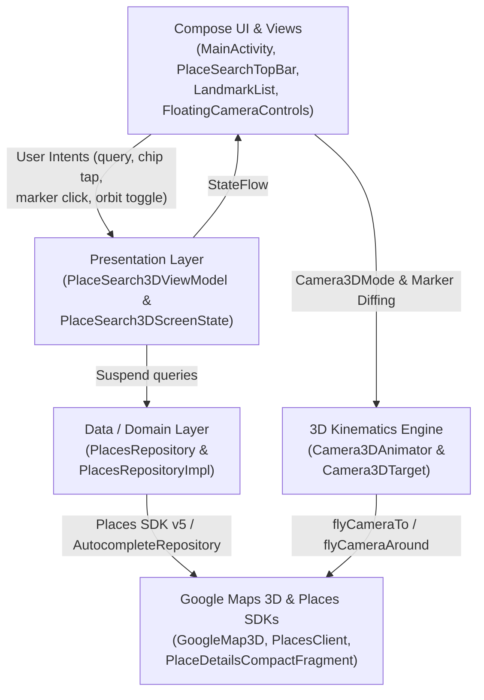

# 📍 Places UI Kit 3D Showcase (`PlacesUIKit3D`)

**`PlacesUIKit3D`** is a standalone showcase application that demonstrates how to combine the **[Google Maps 3D SDK for Android](https://developers.google.com/maps/documentation/maps-3d/android-sdk)** (`play-services-maps3d`), the **[Places SDK for Android](https://developers.google.com/maps/documentation/places/android-sdk/overview)** (`places`), the **[Places UI Kit](https://developers.google.com/maps/documentation/places/android-sdk/place-details)** (`PlaceDetailsCompactFragment`), and **[Places Compose](https://github.com/googlemaps/android-places-compose)** (`places-compose`) into a unified 3D spatial exploration experience.

Built with **Jetpack Compose**, **Material 3**, **Hilt Dependency Injection**, and **Clean Architecture**, this module serves as the reference implementation for Place Search, Place Autocomplete, and Place Details in 3D while the single-feature demo activities in `ComposeDemos` and `ApiDemos` remain lightweight.

---

## 🧭 What You'll Find in This Module

| Feature | Status | Primary Source Files | Description |
| :--- | :--- | :--- | :--- |
| **Place Autocomplete** | ✅ Done | [`PlaceSearchTopBar.kt`](src/main/java/com/example/placesuikit3d/ui/compose/PlaceSearchTopBar.kt)<br>[`PlaceSearch3DViewModel.kt`](src/main/java/com/example/placesuikit3d/ui/viewmodel/PlaceSearch3DViewModel.kt)<br>[`PlacesRepositoryImpl.kt`](src/main/java/com/example/placesuikit3d/data/repository/PlacesRepositoryImpl.kt) | Uses `PlacesAutocompleteTextField` (`places-compose`) with a 300ms coroutine debounce and a 50 km circular location bias around Boulder, CO (`AutocompleteRepository`). Selecting a prediction fetches the place's 3D coordinates and flies the camera directly to it. |
| **Category & Text Search** | ✅ Done | [`PlacesRepositoryImpl.kt`](src/main/java/com/example/placesuikit3d/data/repository/PlacesRepositoryImpl.kt)<br>[`LandmarkList.kt`](src/main/java/com/example/placesuikit3d/LandmarkList.kt) | Quick-filter `FilterChip` bar (`🏛️ Landmarks`, `☕ Cafes`, `🏨 Hotels`, `🍕 Restaurants`, `🎨 Museums`) and free-text search powered by `PlacesClient.searchByText` (`SearchByTextRequest`), displayed in an interactive Material 3 `BottomSheetScaffold`. |
| **Place Details UI Kit Card** | ✅ Done | [`MainActivity.kt`](src/main/java/com/example/placesuikit3d/MainActivity.kt) (`PlaceDetailsOverlay`) | Embeds the official Places UI Kit `PlaceDetailsCompactFragment` inside Compose via `AndroidView` and `FragmentContainerView`. Slides up smoothly when the user taps a 3D marker, a map POI, or an item in the bottom sheet. |
| **Extruded 3D Markers** | ✅ Done | [`MainActivity.kt`](src/main/java/com/example/placesuikit3d/MainActivity.kt) (`updateMapMarkers`)<br>[`Camera3DAnimator.kt`](src/main/java/com/example/placesuikit3d/ui/animation/Camera3DAnimator.kt) | Renders search results on `GoogleMap3D` using `PinConfiguration`, `AltitudeMode.RELATIVE_TO_MESH`, `isExtruded = true` (vertical stem anchoring pins to rooftops/terrain), and `isDrawnWhenOccluded = true`. Dynamically scales pin size and elevation offset when selected. |
| **3D Camera Kinematics** | ✅ Done | [`Camera3DAnimator.kt`](src/main/java/com/example/placesuikit3d/ui/animation/Camera3DAnimator.kt)<br>[`FloatingCameraControls.kt`](src/main/java/com/example/placesuikit3d/ui/compose/FloatingCameraControls.kt)<br>[`Camera3DTarget.kt`](src/main/java/com/example/placesuikit3d/data/model/Camera3DTarget.kt) | Provides smooth `flyCameraTo` transitions, multi-marker bounding-box auto-framing (`Camera3DTarget.fromPlaces`), continuous 360° orbit (`flyCameraAround`), a 2D/3D pitch toggle (`0°` vs `50°` tilt), and Fused Location "My Location" fly-to. |
| **Offline & CI Fallback** | ✅ Done | [`PlacesRepositoryImpl.kt`](src/main/java/com/example/placesuikit3d/data/repository/PlacesRepositoryImpl.kt) | Curated fallback dataset of Boulder, CO landmarks, cafes, hotels, restaurants, and museums so the app remains interactive when offline or running in headless CI environments. |

---

## 🏗️ How the Code Works

`PlacesUIKit3D` follows the 5-layer **Clean Architecture** and **Unidirectional Data Flow (UDF)** design documented in [`ARCHITECTURE.md`](../ARCHITECTURE.md):



### 1. SDK Initialization (`Maps3DPlacesApplication.kt` & `MainActivity.kt`)
* **[`Maps3DPlacesApplication`](src/main/java/com/example/placesuikit3d/Maps3DPlacesApplication.kt)** (annotated with `@HiltAndroidApp`) validates `com.google.android.geo.maps3d.API_KEY` from `AndroidManifest.xml` and initializes the Places SDK with the New Places API enabled:
  ```kotlin
  Places.initializeWithNewPlacesApiEnabled(applicationContext, BuildConfig.PLACES_API_KEY)
  Places.createClient(this)
  ```
* **[`MainActivity`](src/main/java/com/example/placesuikit3d/MainActivity.kt)** hosts the `Map3DView` inside Compose using `AndroidView` (`MapViewContainer`), binds `Map3DView` lifecycle events (`onCreate`, `onResume`, `onPause`, `onDestroy`) via a `LifecycleEventObserver`, and requests the `GoogleMap3D` controller asynchronously (`getMap3DViewAsync(this)`).
* When `onMap3DViewReady(googleMap3D)` fires, the map mode is set to `Map3DMode.HYBRID` (photorealistic 3D mesh with satellite imagery and road labels), initial markers are rendered, and a `Map3DClickListener` is registered so tapping any 3D building or POI opens its Place Details card.

### 2. Unidirectional State & Search Pipeline (`PlaceSearch3DViewModel.kt` & `PlacesRepositoryImpl.kt`)
* **[`PlaceSearch3DViewModel`](src/main/java/com/example/placesuikit3d/ui/viewmodel/PlaceSearch3DViewModel.kt)** exposes a single `StateFlow<PlaceSearch3DScreenState>` (`screenState`) defined in [`PlaceSearch3DUiState.kt`](src/main/java/com/example/placesuikit3d/ui/viewmodel/PlaceSearch3DUiState.kt).
* **Debounced Autocomplete**: When the user types in [`PlaceSearchTopBar`](src/main/java/com/example/placesuikit3d/ui/compose/PlaceSearchTopBar.kt), `onSearchQueryChanged(query)` cancels any in-flight search job, waits `300ms`, and queries [`PlacesRepository.getAutocompleteSuggestions`](src/main/java/com/example/placesuikit3d/data/repository/PlacesRepositoryImpl.kt).
* **Category & Text Search**: Tapping a category chip (`searchByCategory`) or submitting a query (`searchPlaces`) invokes `PlacesClient.searchByText` with a `SearchByTextRequest` requesting `ID`, `DISPLAY_NAME`, `LOCATION`, `FORMATTED_ADDRESS`, `RATING`, `USER_RATING_COUNT`, and `TYPES`, biased around Boulder, CO (`CircularBounds.newInstance(BOULDER_CENTER, 50_000.0)`).
* Once results arrive, the ViewModel updates `allMarkers` and sets `cameraMode = Camera3DMode.FlyingTo(Camera3DTarget.fromPlaces(places))`, triggering the camera to frame all returned pins.

### 3. Diffing & Extruded 3D Markers (`MainActivity.kt#updateMapMarkers`)
Rather than clearing and re-adding every marker on every state emission, `MainActivity.updateMapMarkers()` diffs the incoming `List<PlaceSearchResult>` against `activeMarkers`:
* Markers that are no longer in the result set are removed via `marker.remove()`.
* Existing markers are only recreated if their selection state changed (`isSelected != wasSelected`).
* Each marker is configured with:
  * **`PinConfiguration`**: Google Red (`#EA4335`) with a `#C5221F` border, scaled to `1.35f` when selected (`1.0f` unselected).
  * **`AltitudeMode.RELATIVE_TO_MESH` & `isExtruded = true`**: Positions the pin above the 3D building/terrain mesh using `Camera3DAnimator.calculateDynamicMarkerAltitude()` (clamped between `4m` and `35m` based on camera range and selection state) and draws an extruded vertical stem down to the surface.
  * **`isDrawnWhenOccluded = true` & `CollisionBehavior.REQUIRED`**: Ensures selected and search pins remain visible even behind tall 3D terrain or structures.

### 4. 3D Camera Kinematics (`Camera3DAnimator.kt` & `Camera3DTarget.kt`)
* **[`Camera3DTarget`](src/main/java/com/example/placesuikit3d/data/model/Camera3DTarget.kt)** is a pure-Kotlin model holding `latitude`, `longitude`, `altitude`, `heading`, `tilt`, and `range`. Its companion helper `Camera3DTarget.fromPlaces(places)` computes the geographic centroid and optimal viewing range to fit multiple search results into the 3D viewport.
* **[`Camera3DAnimator`](src/main/java/com/example/placesuikit3d/ui/animation/Camera3DAnimator.kt)** translates high-level camera intents into Maps 3D SDK calls:
  * **`flyToTarget()` / `flyToPlace()`**: Calls `googleMap3D.flyCameraTo(flyToOptions { endCamera = camera; durationInMillis = 2500 })`.
  * **`startOrbit()`**: Launches a coroutine loop that calls `googleMap3D.flyCameraAround(flyAroundOptions { center = baseCamera; durationInMillis = 16000; rounds = 1.0 })` for continuous 360° inspection around the active POI or map center.
  * **`stopOrbit()`**: Cancels the orbit coroutine job and calls `googleMap3D.stopCameraAnimation()` immediately when the user touches the map or starts a new search.

### 5. Places UI Kit Interop in Compose (`MainActivity.kt#PlaceDetailsOverlay`)
When `screenState.selectedPlaceId` is non-null (from tapping a 3D marker, clicking a map POI, or selecting a row in [`LandmarkList`](src/main/java/com/example/placesuikit3d/LandmarkList.kt)), `PlaceDetailsOverlay` animates into view above the bottom sheet:
* Creates a `FragmentContainerView` inside an `AndroidView` and attaches `PlaceDetailsCompactFragment.newInstance(PlaceDetailsCompactFragment.ALL_CONTENT, Orientation.VERTICAL, R.style.CustomizedPlaceDetailsTheme)`.
* Calls `fragment.loadWithPlaceId(placeId)` whenever `selectedPlaceId` changes, and removes the fragment cleanly inside `DisposableEffect.onDispose`.

---

## 📂 Project Structure

```text
PlacesUIKit3D/
├── build.gradle.kts
└── src/
    ├── main/
    │   ├── AndroidManifest.xml
    │   └── java/com/example/placesuikit3d/
    │       ├── Maps3DPlacesApplication.kt          # @HiltAndroidApp entry point & Places SDK initialization
    │       ├── MainActivity.kt                     # Compose host, Map3DView lifecycle, 3D marker diffing & PlaceDetailsCompactFragment overlay
    │       ├── LandmarkList.kt                     # Bottom sheet LazyColumn of PlaceSearchResult items
    │       ├── data/
    │       │   ├── model/
    │       │   │   ├── Camera3DTarget.kt           # 3D camera pose model & multi-place bounding-box calculator
    │       │   │   └── PlaceSearchResult.kt        # Domain model for a 3D-positioned Place result
    │       │   └── repository/
    │       │       ├── PlacesRepository.kt         # Repository interface for search, autocomplete & place details
    │       │       └── PlacesRepositoryImpl.kt     # Places SDK 5.x + AutocompleteRepository implementation with offline fallback
    │       ├── di/
    │       │   └── PlacesRepositoryModule.kt       # Hilt module binding PlacesRepository and StringProvider
    │       ├── ui/
    │       │   ├── animation/
    │       │   │   └── Camera3DAnimator.kt         # Controller for flyCameraTo, flyCameraAround (360° orbit) & dynamic marker altitude
    │       │   ├── compose/
    │       │   │   ├── FloatingCameraControls.kt   # Vertical floating toolbar (360° Orbit, 2D/3D Pitch, Reset Overview, My Location)
    │       │   │   └── PlaceSearchTopBar.kt        # PlacesAutocompleteTextField + category FilterChip row
    │       │   ├── theme/                          # Material 3 color, typography & theme definitions
    │       │   └── viewmodel/
    │       │       ├── PlaceSearch3DUiState.kt     # Immutable UI state & Camera3DMode sealed interfaces
    │       │       └── PlaceSearch3DViewModel.kt   # UDF state holder with 300ms search debounce
    │       └── utils/                              # Camera validation, unit conversion & string resource helpers
    ├── test/java/com/example/placesuikit3d/        # Local JVM & Robolectric unit tests
    │   ├── data/model/Camera3DTargetTest.kt
    │   ├── data/model/PlaceSearchResultTest.kt
    │   ├── data/repository/PlacesRepositoryTest.kt
    │   ├── ui/animation/Camera3DAnimatorTest.kt
    │   └── ui/viewmodel/PlaceSearch3DViewModelTest.kt
    └── androidTest/java/com/example/placesuikit3d/ # Instrumented Compose UI tests
        └── MainActivityTest.kt
```

---

## ⚙️ Setup & Running

### 1. Prerequisites
In your [Google Cloud Console](https://console.cloud.google.com/) project, enable both:
1. **Maps 3D SDK for Android**
2. **Places API (New)**

### 2. Configure API Keys in `secrets.properties`
At the root of the `android-maps3d-samples` repository, copy `local.defaults.properties` to `secrets.properties` (if not already present) and provide your API keys:

```properties
MAPS3D_API_KEY=YOUR_MAPS3D_API_KEY
PLACES_API_KEY=YOUR_PLACES_API_KEY
```
*(You can use the same API key for both properties if it has both **Maps 3D SDK for Android** and **Places API (New)** enabled.)*

### 3. Build & Install
From the repository root, install and launch `PlacesUIKit3D` on a connected device or emulator (API 29+):

```bash
# Build and install the debug APK
./gradlew :PlacesUIKit3D:installDebug

# Or build, install, and launch MainActivity in one step
./gradlew :PlacesUIKit3D:installAndLaunch
```

### 4. Run Tests
```bash
# Run fast JVM / Robolectric unit tests (ViewModel, Repository, Camera3DAnimator, Camera3DTarget)
./gradlew :PlacesUIKit3D:testDebugUnitTest

# Run instrumented Compose tests on a connected device/emulator
./gradlew :PlacesUIKit3D:connectedDebugAndroidTest
```
