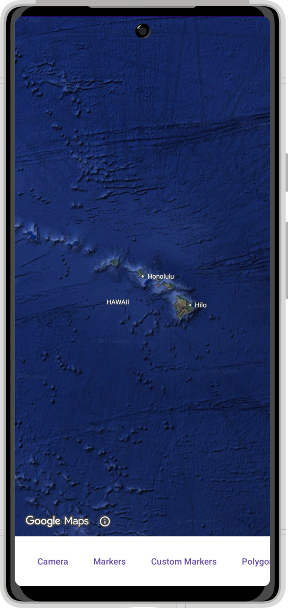
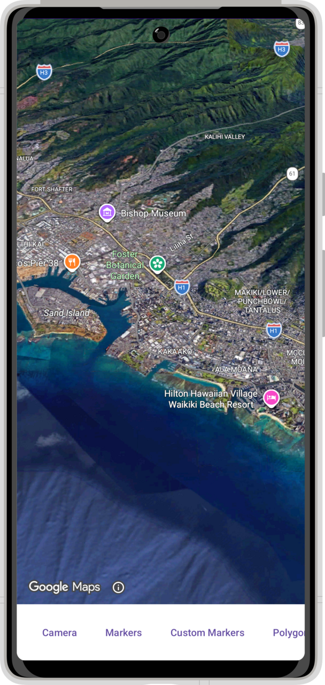
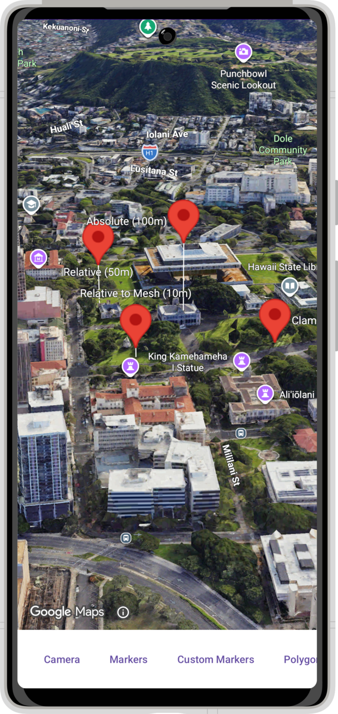
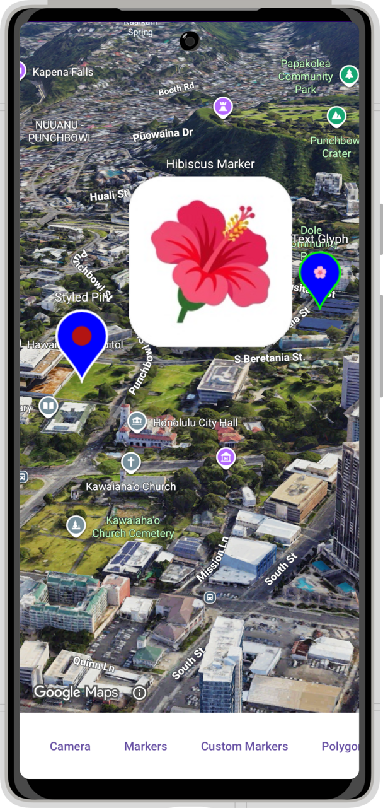
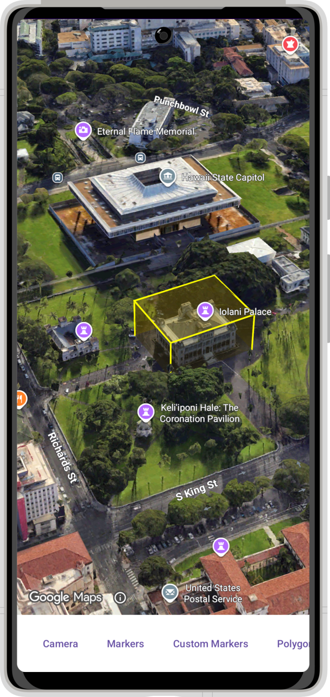
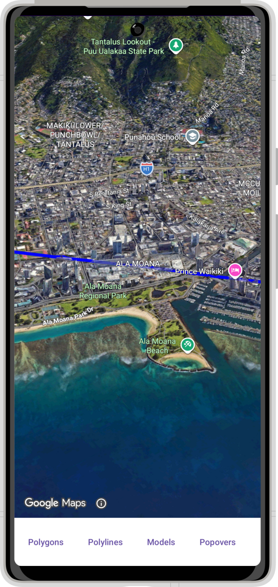
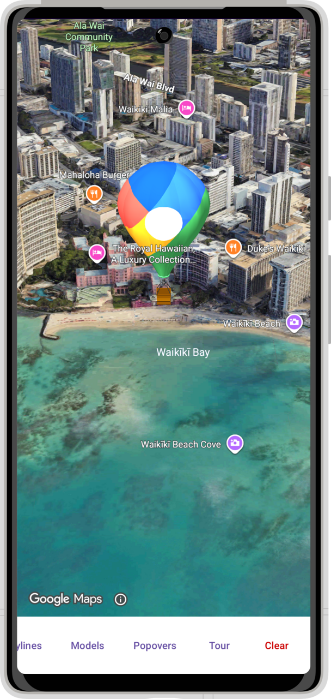
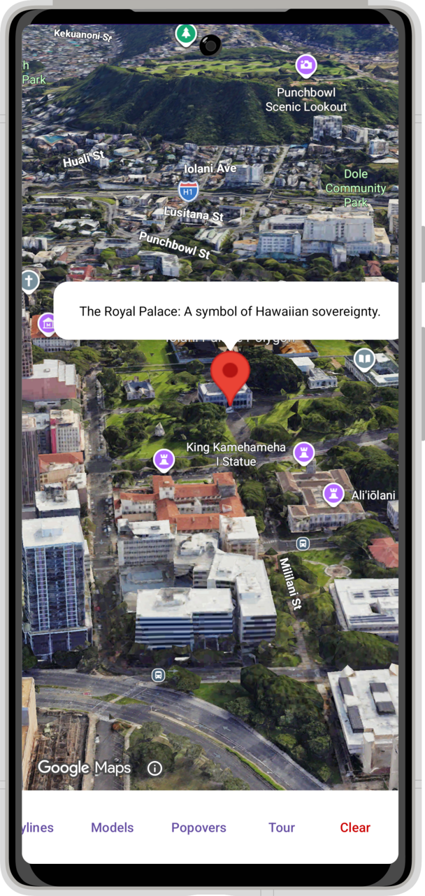
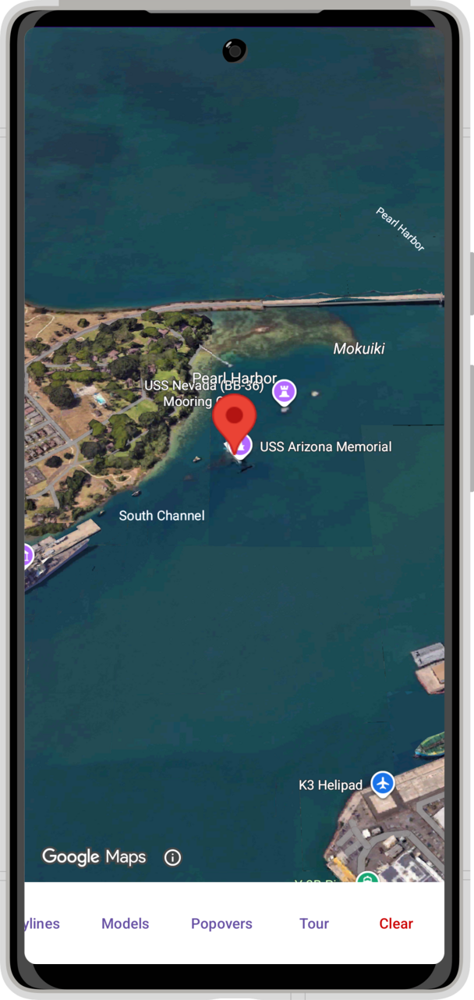
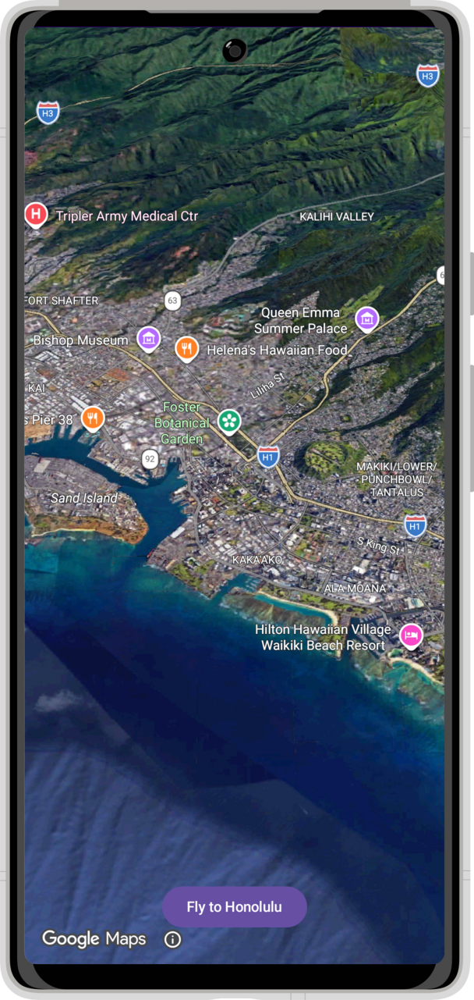

# Codelab: Aloha Explorer — Building with the 3D Maps SDK for Android

Welcome to the future of mobile mapping! In this codelab, we are going to build **Aloha Explorer**, a 3D interactive tour of historic Iolani Palace in Honolulu.

Using the **Google Maps 3D SDK for Android**, you will transform a standard flat map into an immersive 3D experience. We will start with a basic "Hello World" app and add:

*   **Cinematic Camera**: A smooth flight from space down to Honolulu.
*   **3D Markers**: Floating markers pinned to specific altitudes.
*   **3D Volumes**: An extruded polygon visualizing the palace grounds.
*   **3D Models**: A high-fidelity glTF model (a Balloon) floating above the scene.

### What you’ll learn

*   **Initialization**: How to set up the `Map3DView` and handle its lifecycle.
*   **Camera Control**: How to orchestrate smooth animations using Coroutines.
*   **Altitude Modes**: Understanding `ABSOLUTE`, `RELATIVE_TO_GROUND`, `CLAMP_TO_GROUND`, and `RELATIVE_TO_MESH`.
*   **Extrusion**: Turning 2D footprints into 3D volumes.
*   **3D Models**: Loading and placing glTF assets.
*   **Interaction**: Handling click events on 3D objects.

---

## Prerequisites

Before we start coding, ensure your environment is ready.

1.  **Enable the SDK**:
    *   Go to the [Google Cloud Console](https://console.cloud.google.com/marketplace/product/google/maps3d.googleapis.com).
    *   Select your project and click **Enable** to turn on the "Maps 3D SDK for Android".
    *   Make sure you have an API Key created in the "Credentials" section.

2.  **Add Your API Key**:
    To authenticate with Google Maps Platform services, your app must provide an API key. We use the **Secrets Gradle Plugin** to do this securely.

    > [!NOTE]
    > **Why the Secrets Plugin?**
    > Hardcoding an API key into your Android Manifest or source code is dangerous! If you check your code into GitHub, malicious bots can scrape your key!
    >
    > The Secrets Gradle Plugin extracts the key from a local text file and injects it into the build process securely without exposing it to version control.

    The `starter` project comes with the Secrets plugin pre-configured for you! All you need to do is create a new file called `secrets.properties` in the root of your project and add:
    ```properties
    MAPS3D_API_KEY=YOUR_API_KEY_HERE
    ```

3.  **Dependencies**:
    Finally, you need to import the SDK itself. Open `gradle/libs.versions.toml` and uncomment the `playServicesMaps3d` line in the `[versions]` section and the `play-services-maps3d` line in the `[libraries]` section.

    Then, open `app/build.gradle.kts` and uncomment the dependency:
    ```kotlin
    dependencies {
        // ...
        implementation(libs.play.services.maps3d)
    }
    ```

    *   **Be sure to sync the project if you haven't already!**

4.  **Uncomment SDK-Dependent Files**:
    The starter project contains several helper files (`HonoluluData.kt`, `Map3DLifecycleObserver.kt`, and `Utilities.kt`) that rely heavily on the Maps 3D SDK. They were temporarily commented out to prevent compilation errors before you synced the SDK dependency.
    *   Open `HonoluluData.kt`. Remove the `/* TODO: ...` line at the top and the `*/` at the bottom to uncomment the file.
    *   Do the same for `Map3DLifecycleObserver.kt`.
    *   Do the same for `Utilities.kt`.

---

## 1. Setting the Stage (Layout & Init)

Before we can explore the islands, we need to set up our "cockpit". We need a layout that gives the map full focus while keeping our controls accessible.

### Step 1.1: The Layout

Open `app/src/main/res/layout/activity_main.xml`. The layout is mostly provided for you in the starter project. It features a `ConstraintLayout` containing a placeholder `TextView` at the top and a scrollable row of control buttons at the bottom.

To insert the 3D Map, find the `TextView` with the `id` of `@+id/map3dView` and replace the entire `<TextView ... />` block with the `Map3DView` component below.

**Key Changes:**
1.  **Map3DView**: We replace the placeholder with the actual SDK component. Notice all the `app:` attributes provided to configure the initial state of the camera!
2.  **Attributes**: We configure its boundaries, tilt limits, and the initial hybrid map mode.

```xml
    <!-- Replace the placeholder TextView with this Map3DView -->
    <com.google.android.gms.maps3d.Map3DView
        android:id="@+id/map3dView"
        android:layout_width="match_parent"
        android:layout_height="0dp"
        app:mapMode="hybrid"
        app:centerLat="21.3069"
        app:centerLng="-157.8583"
        app:centerAlt="0"
        app:heading="0"
        app:tilt="0"
        app:range="5000000"
        app:roll="0"
        app:minAltitude="0"
        app:maxAltitude="10000000"
        app:minHeading="0"
        app:maxHeading="360"
        app:minTilt="0"
        app:maxTilt="90"
        app:layout_constraintBottom_toTopOf="@id/controls_scroll_view"
        app:layout_constraintEnd_toEndOf="parent"
        app:layout_constraintStart_toStartOf="parent"
        app:layout_constraintTop_toTopOf="parent" />
```

### Step 1.2: Project Skeleton

Open `MainActivity.kt`. We will set up the class structure, uncomment the imports at the top of the file, declare our state tracking lists, and uncomment the `resetMap()` helper. Note that all of our geographic constants and model URLs have been pre-defined for you in `HonoluluData.kt`, and edge-to-edge Window Insets and **Sticky Immersive Mode** are pre-configured in `setUpInsets()`.

> [!TIP]
> **Full-Screen Immersive Mode**
> Inside `setUpInsets()`, we use `WindowCompat.getInsetsController(window, window.decorView)` to hide the system status and navigation bars (`windowInsetsController.hide(WindowInsetsCompat.Type.systemBars())`) with `BEHAVIOR_SHOW_TRANSIENT_BARS_BY_SWIPE`. This gives the 3D scene an unobstructed, full-screen canvas while allowing users to reveal the system bars transiently by swiping from the edge of the screen. If you prefer to keep the system bars visible at all times, simply remove those three lines from `setUpInsets()`.

**Tasks**:
1.  Uncomment the imports at the top of `MainActivity.kt`.
2.  Implement `OnMap3DViewReadyCallback` on `MainActivity`.
3.  Uncomment `map3DView`, `googleMap3D`, the **State Management** lists (`activeMarkers`, `activePolygons`, `activePolylines`, `activeModels`, `activePopovers`), and `resetMap()`.

```kotlin
class MainActivity : AppCompatActivity(), OnMap3DViewReadyCallback {

    // The main view component for the 3D Map.
    private lateinit var map3DView: Map3DView

    // The API object we use to interact with the map once it's ready.
    private var googleMap3D: GoogleMap3D? = null

    // State Management: Track objects to remove them later
    private val activeMarkers = mutableListOf<Marker>()
    private val activePolygons = mutableListOf<Polygon>()
    private val activePolylines = mutableListOf<Polyline>()
    private val activeModels = mutableListOf<Model>()
    private val activePopovers = mutableListOf<Popover>()

    override fun onCreate(savedInstanceState: Bundle?) {
        // Fix: Ensure the bundle can deserialize the Maps 3D SDK's Camera Parcelable on rotation
        savedInstanceState?.classLoader = javaClass.classLoader
        super.onCreate(savedInstanceState)

        enableEdgeToEdge()
        setContentView(R.layout.activity_main)

        setUpInsets()

        // TODO: Step 1.3 - Initialize Map3DView and Map Lifecycle
    }

    // Helper to clear the map before adding new content
    private fun resetMap() {
        activeMarkers.forEach { it.remove() }
        activeMarkers.clear()

        activePolygons.forEach { it.remove() }
        activePolygons.clear()

        activePolylines.forEach { it.remove() }
        activePolylines.clear()

        activeModels.forEach { it.remove() }
        activeModels.clear()

        activePopovers.forEach { it.remove() }
        activePopovers.clear()
    }

    // We'll implement onMap3DViewReady in the next step!
    override fun onMap3DViewReady(googleMap3D: GoogleMap3D) {
        // TODO: Initialize map
    }

    private fun setUpInsets() {
        // Immersive Mode: Hide the system bars (status bar and navigation bar) for a
        // full-screen 3D map experience. Swiping from the screen edge reveals them transiently.
        // Remove these lines if you prefer to keep the system bars visible at all times.
        val windowInsetsController = WindowCompat.getInsetsController(window, window.decorView)
        windowInsetsController.systemBarsBehavior =
            WindowInsetsControllerCompat.BEHAVIOR_SHOW_TRANSIENT_BARS_BY_SWIPE
        windowInsetsController.hide(WindowInsetsCompat.Type.systemBars())

        // Window Insets Handling: Ensure bottom UI controls don't get covered by the
        // navigation bar when system bars are visible.
        ViewCompat.setOnApplyWindowInsetsListener(findViewById(R.id.controls_scroll_view)) { v, insets ->
            val systemBars = insets.getInsets(WindowInsetsCompat.Type.systemBars())
            val basePadding = (16 * resources.displayMetrics.density).toInt() // 16dp
            v.setPadding(
                systemBars.left,
                basePadding,
                systemBars.right,
                systemBars.bottom + basePadding
            )
            insets
        }
    }
}
```

### Step 1.3: Initialize the Map

Now let's initialize the `Map3DView`, register our lifecycle observer, and implement the map-ready callback.

1.  **Initialize View**: Add the `map3DView` setup code to the end of `onCreate`.
2.  **Handle Callback**: Implement `onMap3DViewReady` and `startFromGlobalView` to position the camera high above Honolulu.
3.  **Setup Controls**: Uncomment `setupButtons` and `flyCameraToAndWait` at the bottom of `MainActivity.kt`.

Add this logic to `MainActivity.kt`:

```kotlin
    override fun onCreate(savedInstanceState: Bundle?) {
        // ... previous code ...

        // 1.3. Initialize Map3DView
        map3DView = findViewById(R.id.map3dView)

        // 1.4. Map Lifecycle
        // Manually trigger onCreate (and unpack any saved state from rotation)
        val mapState = savedStateRegistry.consumeRestoredStateForKey("map3d_state_provider")
        map3DView.onCreate(mapState)

        // Attach the automated Lifecycle Observer
        lifecycle.addObserver(Map3DLifecycleObserver(map3DView, this))

        map3DView.getMap3DViewAsync(this)
    }

    override fun onMap3DViewReady(googleMap3D: GoogleMap3D) {
        this@MainActivity.googleMap3D = googleMap3D

        lifecycleScope.launch {
            // 1.3. Start from Global View
            startFromGlobalView(googleMap3D)

            // Setup UI Buttons
            setupButtons(googleMap3D)
        }
    }

    private fun startFromGlobalView(map: GoogleMap3D) {
        // Initial Position: "Global View" aka Space View
        map.setCamera(
            camera {
                center = HONOLULU
                tilt = 0.0 // Looking straight down
                heading = 0.0
                range = 5_000_000.0 // 5,000 km altitude for a wide view
            }
        )
    }
```

> [!NOTE]
> When you uncomment `setupButtons(googleMap3D)` at the bottom of your file, you will see unresolved reference errors for `flyToHonolulu`, `addMarkers`, and the other feature helper functions called inside `setupButtons`. Don't worry! We will implement each of these in the next sections.



### Step 1.4: Map Lifecycle (The Modern Way)

Unlike standard Android Views, the `Map3DView` contains a powerful 3D rendering engine that must be explicitly paused and resumed to preserve battery life and system resources.

Normally, this would mean overriding `onResume`, `onPause`, `onDestroy`, and `onSaveInstanceState` in your `MainActivity` and manually forwarding those events to the map.

**To avoid this messy boilerplate, we have pre-provided `Map3DLifecycleObserver.kt`.**

This useful utility class implements `DefaultLifecycleObserver`. By calling `lifecycle.addObserver(Map3DLifecycleObserver(map3DView, this))` inside `onCreate`, the map will automatically listen to your Activity's lifecycle events, keeping your UI controller clean!

---

## 2. The Royal Flyover (Camera Mastery)

Now that we’re in Hawaii, let's head to the historic **Iolani Palace**. Unlike 2D maps where you just "pan", 3D maps allow cinematic camera movements.

### Objective
We want to fly from space down to Honolulu, and then orbit the palace.

### The Setup
We use `flyToOptions` to define the flight:

```kotlin
private suspend fun flyToHonolulu(map: GoogleMap3D) {
    // Duration using Kotlin Duration extension
    val flyDuration = 5.seconds

    map.flyCameraTo(
        flyToOptions {
            endCamera = camera {
                center = HONOLULU
                tilt = 45.0 // Angled view
                range = 20_000.0 // 20km away
                heading = 0.0
            }
            durationInMillis = flyDuration.inWholeMilliseconds
        }
    )
    // Next: How do we wait for the flight to finish before orbiting?
}
```

---

## 3. Robustness (The Secret Sauce)

Here is where many developers trip up. Animations take time. Network loading takes time. If you just chain commands together immediately, the camera might try to move before the map is ready.

**The Solution: Suspending Helper Functions**

> [!NOTE]
> **Deep Dive: The Magic of `suspendCancellableCoroutine`**
> The Maps 3D SDK relies heavily on trailing callback functions (e.g. `setCameraAnimationEndListener`). If you want to fly to five different places sequentially, chaining five callbacks inside each other quickly turns into an unreadable "Pyramid of Doom" (affectionately known as Callback Hell).
>
> By wrapping these listeners inside Kotlin's `suspendCancellableCoroutine`, we temporarily pause the execution of our Kotlin code *without blocking the main UI thread*! Once the Maps SDK fires the callback indicating the flight is over, `continuation.resume(Unit)` allows our code to cleanly wake back up and proceed to the next line.
>
> **The Result:** We can write flat, sequential, and highly readable synchronous-looking code!

Open `Utilities.kt` to see how we wrap the SDK's callback-based listeners into Kotlin Coroutine `suspend` extension functions on `GoogleMap3D`. This lets us write linear, readable code like "Fly THERE, then wait, then Orbit HERE".

```kotlin
// Registers the animation-end listener before starting the flight, and stops the camera if cancelled
suspend fun GoogleMap3D.awaitCameraAnimation(options: FlyToOptions) = suspendCancellableCoroutine { continuation ->
    setCameraAnimationEndListener {
        setCameraAnimationEndListener(null) // Cleanup
        if (continuation.isActive) {
            continuation.resume(Unit)
        }
    }
    flyCameraTo(options)

    continuation.invokeOnCancellation {
        stopCameraAnimation()
        setCameraAnimationEndListener(null)
    }
}

suspend fun GoogleMap3D.awaitCameraAnimation(options: FlyAroundOptions) = suspendCancellableCoroutine { continuation ->
    setCameraAnimationEndListener {
        setCameraAnimationEndListener(null) // Cleanup
        if (continuation.isActive) {
            continuation.resume(Unit)
        }
    }
    flyCameraAround(options)

    continuation.invokeOnCancellation {
        stopCameraAnimation()
        setCameraAnimationEndListener(null)
    }
}

// Pauses execution until the map tiles are fully loaded and steady (with a safety timeout)
suspend fun GoogleMap3D.awaitMapSteady(timeout: Duration = 5.seconds): Boolean {
    return withTimeoutOrNull(timeout) {
        suspendCancellableCoroutine { continuation ->
            setOnMapSteadyListener { isSteady ->
                if (isSteady) {
                    setOnMapSteadyListener(null) // Cleanup the listener
                    if (continuation.isActive) {
                        continuation.resume(true) // Resume the suspended coroutine
                    }
                }
            }

            // Safety: If the coroutine is cancelled or times out, remove the listener.
            continuation.invokeOnCancellation {
                setOnMapSteadyListener(null)
            }
        }
    } ?: false
}
```

Now update `flyToHonolulu` in `MainActivity.kt` to use `awaitCameraAnimation` and `awaitMapSteady` so the camera flies in, waits for the 3D tiles to settle, and then orbits Honolulu:

```kotlin
    private suspend fun flyToHonolulu(map: GoogleMap3D) {
        // Duration for the animation
        val flyDuration = 5.seconds
        val orbitDuration = 10.seconds

        // Fly to Honolulu and wait for the animation to finish
        map.awaitCameraAnimation(
            // **FlyToOptions**: Configures how the camera moves.
            flyToOptions {
                endCamera = camera {
                    center = HONOLULU
                    tilt = 45.0
                    range = 20_000.0 // Zoomed out a bit from the city
                    heading = 0.0
                }
                durationInMillis = flyDuration.inWholeMilliseconds
            }
        )
        map.awaitMapSteady(5.seconds) // Wait for tiles to load and settle

        // Orbit around Honolulu and wait for the animation to finish
        map.awaitCameraAnimation(
            flyAroundOptions {
                // **FlyAroundOptions**: Orbits around a specific point.
                center = camera {
                    center = HONOLULU
                    tilt = 45.0
                    range = 20_000.0
                    heading = 0.0
                }
                rounds = 1.0 // One full circle
                durationInMillis = orbitDuration.inWholeMilliseconds
            }
        )
    }
```



---

## 4. Sticking the Landing (Markers & Altitude)

Objects in a 3D world need to know where they sit on the vertical "Z-axis".

### The 4 Modes of Altitude
1.  **ABSOLUTE**: Relative to sea level (WGS84). Good for airplanes.
2.  **RELATIVE_TO_GROUND**: Relative to the terrain height. Good for things floating *above* the ground.
3.  **CLAMP_TO_GROUND**: Snaps to the terrain. Good for POIs.
4.  **RELATIVE_TO_MESH**: Relative to the actual 3D objects (buildings/trees). Good for placing things on rooftops.

### Helper: `resetMap()` and `addClickableMarker()`

You noticed we call `resetMap()` at the start. This prevents "ghost objects"—markers from previous clicks staying on the map. We iterate through our tracking lists (`activeMarkers`, etc.), call `.remove()` on each object to clear it from the 3D engine, and then clear the list.

We also use a custom `addClickableMarker(map: GoogleMap3D, markerOptions: MarkerOptions)` helper method. Instead of duplicating the `Toast` listener and the list-tracking logic for every single marker, this helper centralizes it:

```kotlin
    private fun addClickableMarker(map: GoogleMap3D, markerOptions: MarkerOptions) {
        map.addMarker(markerOptions)?.also { marker ->
            marker.setClickListener {
                lifecycleScope.launch(Dispatchers.Main) {
                    Toast.makeText(
                        this@MainActivity,
                        getString(R.string.toast_clicked, marker.label),
                        Toast.LENGTH_SHORT
                    ).show()
                }
            }
            activeMarkers.add(marker)
        }
    }
```

Now implement `addMarkers(map: GoogleMap3D)` in `MainActivity.kt`:

```kotlin
    private fun addMarkers(map: GoogleMap3D) {
        resetMap()

        // 4.1. ABSOLUTE: Altitude is relative to the WGS84 ellipsoid (rough sea level).
        addClickableMarker(map, markerOptions {
            position = latLngAltitude {
                latitude = IOLANI_PALACE.latitude
                longitude = IOLANI_PALACE.longitude
                altitude = 100.0 // 100 meters above sea level
            }
            altitudeMode = AltitudeMode.ABSOLUTE
            label = getString(R.string.label_absolute)
            isDrawnWhenOccluded = true
            isExtruded = true // Draws a line to the ground
        })

        // 4.2. RELATIVE_TO_GROUND: Altitude is added to the terrain height at that point.
        addClickableMarker(map, markerOptions {
            position = latLngAltitude {
                latitude = IOLANI_PALACE.latitude + 0.001
                longitude = IOLANI_PALACE.longitude
                altitude = 50.0 // 50m above ground
            }
            altitudeMode = AltitudeMode.RELATIVE_TO_GROUND
            label = getString(R.string.label_relative)
            isDrawnWhenOccluded = true
            isExtruded = true
        })

        // 4.3. CLAMP_TO_GROUND: Snaps to the terrain.
        addClickableMarker(map, markerOptions {
            position = latLngAltitude {
                latitude = IOLANI_PALACE.latitude - 0.001
                longitude = IOLANI_PALACE.longitude
                altitude = 0.0 // Ignored
            }
            altitudeMode = AltitudeMode.CLAMP_TO_GROUND
            label = getString(R.string.label_clamped)
            isDrawnWhenOccluded = true
            isExtruded = true
        })

        // 4.4. RELATIVE_TO_MESH: Relative to 3D buildings/trees.
        addClickableMarker(map, markerOptions {
            position = latLngAltitude {
                latitude = IOLANI_PALACE.latitude
                longitude = IOLANI_PALACE.longitude - 0.001
                altitude = 10.0 // 10m above the 3D mesh surface
            }
            altitudeMode = AltitudeMode.RELATIVE_TO_MESH
            label = getString(R.string.label_relative_mesh)
            isDrawnWhenOccluded = true
            isExtruded = true
        })
    }
```



---

## 5. Advanced Custom Markers

Markers don't have to be just standard red pins. The Maps 3D SDK allows you to heavily customize their appearance using the `setStyle()` method on `MarkerOptions`.

Here we'll add three new markers next to Iolani Palace to demonstrate:
1.  **A Styled Pin**: A customized standard pin with a specific color and scale.
2.  **An Image Glyph**: A marker that uses a standard Android Drawable resource (a Hibiscus flower).
3.  **A Text Glyph**: A marker that uses an emoji (`🌸`) scaled elegantly.

Add the following function below `addMarkers`:

```kotlin
    private fun addCustomMarkers(map: GoogleMap3D) {
        resetMap()

        // 5.1. Styled Pin
        addClickableMarker(map, markerOptions {
            position = latLngAltitude {
                latitude = IOLANI_PALACE.latitude
                longitude = IOLANI_PALACE.longitude + 0.002
                altitude = 0.0
            }
            label = getString(R.string.label_styled_pin)
            altitudeMode = AltitudeMode.CLAMP_TO_GROUND
            setStyle(pinConfiguration {
                backgroundColor = Color.BLUE
                borderColor = Color.WHITE
                scale = 1.5f
            })
        })

        // 5.2. Image Glyph (Hibiscus)
        addClickableMarker(map, markerOptions {
            position = latLngAltitude {
                latitude = IOLANI_PALACE.latitude
                longitude = IOLANI_PALACE.longitude + 0.004
                altitude = 0.0
            }
            label = getString(R.string.label_hibiscus)
            isExtruded = true
            isDrawnWhenOccluded = true
            altitudeMode = AltitudeMode.CLAMP_TO_GROUND
            setStyle(ImageView(R.drawable.hibiscus))
        })

        // 5.3. Text Glyph
        val glyphText = Glyph.fromColor(Color.YELLOW).apply {
            setText("🌸")
        }

        addClickableMarker(map, markerOptions {
            position = latLngAltitude {
                latitude = IOLANI_PALACE.latitude
                longitude = IOLANI_PALACE.longitude + 0.006
                altitude = 0.0
            }
            label = getString(R.string.label_text_glyph)
            isExtruded = true
            isDrawnWhenOccluded = true
            altitudeMode = AltitudeMode.CLAMP_TO_GROUND
            setStyle(pinConfiguration {
                setGlyph(glyphText)
                scale = 1.2f
                backgroundColor = Color.BLUE
                borderColor = Color.GREEN
            })
        })
    }
```



---

## 6. Highlighting History (Polygons & Extrusion)

Let's highlight the Palace grounds. A flat polygon is okay, but a 3D volume is better.

> [!NOTE]
> **Native Extrusion vs. Custom 3D Prisms**
> `PolygonOptions` supports native extrusion out of the box via `extruded = true` (paired with `AltitudeMode.RELATIVE_TO_GROUND` and a non-zero vertex `altitude`, plus optional `innerPaths` for interior holes). In this step, we also demonstrate how to construct an explicit 6-face prism (`extrudePolygon` in `Utilities.kt`) when you want individual control over top, bottom, and wall faces.

### Extrusion Algorithm
Open `Utilities.kt` to review the `extrudePolygon` helper function. We can "extrude" a flat shape by:
1.  Taking the base coordinates.
2.  Duplicating them at a higher altitude (the "roof").
3.  Stitching the sides together with new polygons.

```kotlin
// Helper function in Utilities.kt to create the 3D extrusion geometry
fun extrudePolygon(
    basePoints: List<LatLngAltitude>,
    extrusionHeight: Double
): List<List<LatLngAltitude>> {
    if (basePoints.size < 3) return emptyList()
    if (extrusionHeight <= 0) return emptyList()

    val baseAltitude = basePoints.first().altitude

    // 1. Create points for the top face
    val topPoints = basePoints.map { basePoint ->
        latLngAltitude {
            latitude = basePoint.latitude
            longitude = basePoint.longitude
            altitude = baseAltitude + extrusionHeight
        }
    }

    val faces = mutableListOf<List<LatLngAltitude>>()
    faces.add(basePoints.toList()) // Bottom
    faces.add(topPoints.toList().reversed()) // Top (reversed for upward-facing winding order)

    // 2. Create side wall faces
    for (i in basePoints.indices) {
        val p1Base = basePoints[i]
        val p2Base = basePoints[(i + 1) % basePoints.size]
        val p1Top = topPoints[i]
        val p2Top = topPoints[(i + 1) % basePoints.size]

        faces.add(listOf(p1Base, p2Base, p2Top, p1Top))
    }
    return faces
}
```

> [!TIP]
> **Visualizing the Extrusion Math**
> When stitching the vertical side walls, we create a single face polygon using four vertices: two from the "ground" (Base) and two directly above them (Top) at the extrusion altitude.
>
> ```text
>        p1Top -------- p2Top     (Altitude: 35.0)
>          |              |
>          |  (Side Wall) |
>          |              |
>       p1Base ------- p2Base     (Altitude:  0.0)
> ```
> By looping this logic for every pair of points around the perimeter, we seamlessly form an unbroken 3D perimeter wall.

### Adding the Extruded Polygon to the Map
In `MainActivity.kt`, implement `addPolygon(map: GoogleMap3D)` to extrude `IOLANI_PALACE_GEO` to 35 meters and add each face to the map using `AltitudeMode.ABSOLUTE`:

```kotlin
    private fun addPolygon(map: GoogleMap3D) {
        resetMap()

        // Define the base (ground) shape of Iolani Palace.
        // Uses the constant defined in HonoluluData.kt
        val palaceBaseFace = IOLANI_PALACE_GEO.windowed(2, 2).map {
            latLngAltitude { latitude = it[0]; longitude = it[1]; altitude = 0.0 }
        }.let { points -> points + points.first() }

        // Extrude: Turn a 2D shape into a 3D building by duplicating the path upwards
        // and connecting the edges.
        val palaceCube = extrudePolygon(palaceBaseFace, 35.0) // 35 meters tall

        // Add all faces (top, bottom, sides) to the map
        palaceCube.forEach { facePoints ->
            map.addPolygon(
                polygonOptions {
                    path = facePoints
                    fillColor = Color.argb(100, 255, 215, 0) // Gold with transparency
                    strokeColor = Color.YELLOW
                    strokeWidth = 5.0
                    altitudeMode = AltitudeMode.ABSOLUTE
                }
            ).also { face ->
                // Remember the polygon for clean up
                activePolygons.add(face)
            }
        }
    }
```



---

## 7. Interaction (Touching the World)

A map isn't an image; it's an interface. Let's make our 3D palace polygons interactive by attaching a click listener inside the `.also { face -> ... }` block in `addPolygon`:

```kotlin
            ).also { face ->
                // Remember the polygon for clean up
                activePolygons.add(face)

                // 7.1. Tapping the Turf
                // Add click listener to each face
                face.setClickListener {
                    lifecycleScope.launch(Dispatchers.Main) {
                        Toast.makeText(
                            this@MainActivity,
                            getString(R.string.the_royal_palace),
                            Toast.LENGTH_SHORT
                        ).show()
                    }
                }
            }
```

---

## 8. Connecting the Dots (Polylines)

While markers show discrete locations, polylines show paths. Let's draw a geodesic path from Iolani Palace to Waikiki Beach.

Just like Polygons, Polylines are drawn point-by-point. Implement `setupPolylines(map: GoogleMap3D)` in `MainActivity.kt`:

```kotlin
    private fun setupPolylines(map: GoogleMap3D) {
        resetMap()

        // 8. Polylines
        // Draw path to Waikiki
        activePolylines.add(map.addPolyline(
            polylineOptions {
                path = listOf(IOLANI_PALACE, WAIKIKI)
                strokeWidth = 10.0
                strokeColor = Color.BLUE
                altitudeMode = AltitudeMode.CLAMP_TO_GROUND
                geodesic = true
                drawsOccludedSegments = true
            }
        ))
    }
```



---

## 9. Up, Up, and Away (The Balloon)

Finally, let's have some fun. We'll load a 3D asset (a glTF file) of a Hot Air Balloon and place it over Waikiki.

### Adding a Model
Models are just like markers, but with 3D geometry. Implement `setupBalloon(map: GoogleMap3D)` in `MainActivity.kt`, attach a click listener, and add the model to `activeModels` so `resetMap()` can clean it up:

```kotlin
    private fun setupBalloon(map: GoogleMap3D) {
        resetMap()

        // Add "Balloon" Model (glTF)
        val balloon = map.addModel(
            modelOptions {
                position = latLngAltitude {
                    latitude = WAIKIKI.latitude
                    longitude = WAIKIKI.longitude
                    altitude = 20.0 // Float 20 meters above the beach
                }
                altitudeMode = AltitudeMode.ABSOLUTE
                orientation = orientation {
                    heading = 0.0 // North
                    tilt = 0.0    // Upright
                    roll = 0.0    // Level
                }
                url = BALLOON_MODEL_URL
                scale = vector3D { x = BALLOON_SCALE; y = BALLOON_SCALE; z = BALLOON_SCALE }
            }
        )

        // Add click listener
        balloon.setClickListener {
            lifecycleScope.launch(Dispatchers.Main) {
                Toast.makeText(
                    this@MainActivity,
                    getString(R.string.clicked_the_balloon),
                    Toast.LENGTH_SHORT
                ).show()
            }
        }

        // Track it so we can remove it later
        activeModels.add(balloon)
    }
```



---

## 10. Popovers (Info Windows)

Markers are great, but sometimes you need to show more information. **Popovers** are 2D views that "stick" to a 3D location or marker. Unlike Markers, they always face the camera and can contain any Android View (button, text, image, etc.).

### Creating a Popover

In this example, we will attach a popover message directly to the Iolani Palace marker (`positionAnchor = palaceMarker`).

1.  **Add the Anchor Marker**: Place a marker at `IOLANI_PALACE`.
2.  **Create the View**: Create a standard Android `TextView` programmatically.
3.  **Configure the Popover**: Use `popoverOptions` to anchor the popover to `palaceMarker` and style it.

```kotlin
    private fun setupPopover(map: GoogleMap3D) {
        resetMap()

        // 10.1. Add a marker to serve as a visual anchor reference
        val palaceMarker = map.addMarker(
            markerOptions {
                position = IOLANI_PALACE
                label = getString(R.string.label_polygon)
                altitudeMode = AltitudeMode.CLAMP_TO_GROUND
                isExtruded = true
            }
        ) ?: return
        activeMarkers.add(palaceMarker)

        // 10.2. Create a simple text view for the popover content
        // In a real app, you could inflate this from XML using layoutInflater
        val textView = TextView(this@MainActivity).apply {
            text = getString(R.string.toast_palace)
            setPadding(32, 16, 32, 16)
            setTextColor(Color.BLACK)
            setBackgroundColor(Color.WHITE)
        }

        // 10.3. Add a Popover attached to the marker
        val popover = map.addPopover(popoverOptions {
            positionAnchor = palaceMarker
            altitudeMode = AltitudeMode.RELATIVE_TO_MESH
            content = textView
            autoCloseEnabled = true // Close when user clicks elsewhere
            autoPanEnabled = true   // Move camera to ensure popover is visible
            popoverStyle = popoverStyle {
                backgroundColor = Color.WHITE
                borderRadius = 16f
                shadow = popoverShadow {
                    color = Color.DKGRAY
                    radius = 8f
                    offsetX = 4f
                    offsetY = 4f
                }
            }
        })

        // Track it
        activePopovers.add(popover)

        // 10.4. Show popover on marker click (and show immediately for demo purposes)
        palaceMarker.setClickListener {
            popover.show()
        }
        popover.show()
    }
```

Popovers bridge the gap between the 3D world and 2D information. They are perfect for labels, detailed info windows, or even interactive menus.



---

## 11. The Scenic Tour (Animating Between Markers)

Let's spread our wings and explore the whole island! In this step, we'll scatter markers across Oahu's most famous landmarks and animate the camera flying point-to-point.

1. Verify that the `btn_tour` and `btn_clear` buttons are present in your `activity_main.xml` layout, next to the other buttons.
2. Verify that the geographic constants for the landmarks are defined in `HonoluluData.kt`.
3. Add a helper function `flyTour` to orchestrate the flight:

```kotlin
    private suspend fun flyTour(map: GoogleMap3D) {
        val locations = listOf(
            HONOLULU to getString(R.string.tour_honolulu),
            DIAMOND_HEAD to getString(R.string.tour_diamond_head),
            HANAUMA_BAY to getString(R.string.tour_hanauma_bay),
            KOKO_HEAD to getString(R.string.tour_koko_head),
            LANIKAI_BEACH to getString(R.string.tour_lanikai_beach),
            MOUNT_KAALA to getString(R.string.tour_mount_kaala),
            PEARL_HARBOR to getString(R.string.tour_pearl_harbor)
        )

        // Add all markers for the tour
        resetMap()
        locations.forEach { (location, name) ->
            activeMarkers.add(map.addMarker(
                markerOptions {
                    position = location
                    label = name
                    altitudeMode = AltitudeMode.CLAMP_TO_GROUND
                    isExtruded = true
                }
            )!!)
        }

        // Fly to each location
        for ((location, _) in locations) {
            // TODO: CHALLENGE!
            // 1. Create a target Camera for this 'location' (tilt = 45.0, range = 2500.0, heading = 0.0).
            // 2. Fly to the camera and wait using flyCameraToAndWait(map, camera, duration = 3.seconds).
            // 3. Wait for the 3D scene tiles to load using map.awaitMapSteady(5.seconds).
            // 4. Orbit 360 degrees around the camera using map.awaitCameraAnimation(flyAroundOptions { ... }).
            // 5. Pause briefly using delay(1.5.seconds) before moving to the next stop!

        }
    }
```

<details>
<summary><strong>Click to view the completed <code>flyTour</code> solution</strong></summary>

```kotlin
        // Fly to each location
        for ((location, _) in locations) {
            val camera = camera {
                center = location
                tilt = 45.0
                range = 2500.0
                heading = 0.0
            }

            flyCameraToAndWait(
                map,
                camera,
                duration = 3.seconds
            )

            // Wait for the scene to load (with a 5-second timeout so it never hangs)
            map.awaitMapSteady(5.seconds)

            map.awaitCameraAnimation(
                flyAroundOptions {
                    center = camera
                    rounds = 1.0
                    durationInMillis = 3.seconds.inWholeMilliseconds
                }
            )

            // Pause at each location
            delay(1.5.seconds)
        }
```

</details>

### Stopping Animations

If the tour is running and the user clicks another button, we must cancel the existing animation. Notice in `setupButtons` we store the `lifecycleScope.launch` coroutine in `currentAnimationJob` and call `currentAnimationJob?.cancel()` before starting any new action:

```kotlin
        findViewById<Button>(R.id.btn_tour).setOnClickListener {
            currentAnimationJob?.cancel()
            currentAnimationJob = lifecycleScope.launch {
                flyTour(map)
            }
        }

        findViewById<Button>(R.id.btn_clear).setOnClickListener {
            currentAnimationJob?.cancel()
            resetMap()
        }
```



---

## 12. Bonus: Jetpack Compose

Prefer **Jetpack Compose** over XML? The Maps 3D SDK is View-based, but is a perfect candidate for `AndroidView`.

Open `Map3DComposeActivity.kt`, uncomment the imports at the top of the file, and follow the steps below to complete the Compose implementation.

### 1. Configure `Map3DInitConfig`
First, define how the map should initialize using `Map3DInitConfig.create(...)`.

```kotlin
val map3DConfig: Map3DInitConfig = Map3DInitConfig.create(
    centerLat = HONOLULU.latitude,
    centerLng = HONOLULU.longitude,
    centerAlt = 1000.0,
    heading = 0.0,
    range = 10_000_000.0, // Start from space
    mapMode = Map3DMode.HYBRID,
)
```

### 2. The Composable Wrapper

We'll build the `Map3DContainer` step-by-step.

#### 2.1 State & AndroidView Skeleton

First, we need to bridge the gap between Compose and the View system using `AndroidView`. We also need to hold the `GoogleMap3D` object in our Compose state.

```kotlin
@Composable
fun Map3DContainer(
    modifier: Modifier = Modifier,
    config: Map3DInitConfig,
) {
    // State to hold the map controller
    var googleMap by remember { mutableStateOf<GoogleMap3D?>(null) }

    Box(modifier = modifier.fillMaxSize()) {
        AndroidView(
            modifier = Modifier.fillMaxSize(),
            factory = { context ->
                Map3DView(context, config)
            }
        )
    }
}
```

#### 2.2 Initializing the View (`factory`)

The `factory` lambda is called *once* to create the View. We must manually initialize the `Map3DView`'s lifecycle here.

```kotlin
factory = { context ->
    Map3DView(context, config).apply {
        // Manually call onCreate and onResume. In a real app, wire this to LifecycleOwner.
        onCreate(null)
        onResume()
    }
},
```

#### 2.3 Capturing the Map (`update`)

The `update` lambda runs when the Composable recomposes. We use `getMap3DViewAsync` to extract the `GoogleMap3D` controller and save it to our state.

```kotlin
update = { view ->
    view.getMap3DViewAsync(
        object : OnMap3DViewReadyCallback {
            override fun onMap3DViewReady(map3D: GoogleMap3D) {
                googleMap = map3D
            }
            override fun onError(e: Exception) {
                googleMap = null
                throw e
            }
        }
    )
},
```

#### 2.4 Cleanup (`onRelease`)

To prevent memory leaks, we must pause and destroy the view when the Composable is removed from the screen.

```kotlin
onRelease = { view ->
    googleMap = null
    view.onPause()
    view.onDestroy()
}
```

#### 2.5 Adding Interaction

Finally, let's overlay a Button to trigger our cinematic flight. We use a `Job` to manage the animation cancellation.

```kotlin
// Add this state to track animations
val coroutineScope = rememberCoroutineScope()
var animationJob by remember { mutableStateOf<Job?>(null) }

// ... inside Box, after AndroidView ...

Button(
    // Enable only if map is ready and not currently animating
    enabled = googleMap != null && animationJob == null,
    onClick = {
        animationJob?.cancel()
        googleMap?.let { map ->
            animationJob = coroutineScope.launch {
                // 1. Fly to Honolulu
                map.awaitCameraAnimation(
                    flyToOptions {
                        endCamera = camera {
                            center = HONOLULU
                            tilt = 45.0
                            range = 20_000.0
                        }
                        durationInMillis = 2000L
                    }
                )

                // 2. Orbit
                map.awaitCameraAnimation(
                    flyAroundOptions {
                        center = camera {
                            center = HONOLULU
                            tilt = 45.0
                            range = 20_000.0
                        }
                        rounds = 1.0
                        durationInMillis = 5000L
                    }
                )

                animationJob = null
            }
        }
    },
    modifier = Modifier
        .align(Alignment.BottomCenter)
        .padding(bottom = 32.dp)
) {
    Text(stringResource(R.string.fly_to_honolulu))
}
```

### 3. The Activity & Manifest Setup
Finally, use `setContent` to display your Composable in `Map3DComposeActivity`, and uncomment the `<activity android:name=".Map3DComposeActivity" ... />` entry in `app/src/main/AndroidManifest.xml`:

```kotlin
class Map3DComposeActivity : ComponentActivity() {
    override fun onCreate(savedInstanceState: Bundle?) {
        super.onCreate(savedInstanceState)
        enableEdgeToEdge()
        setContent {
            Scaffold(modifier = Modifier.fillMaxSize()) { innerPadding ->
                Map3DContainer(
                    modifier = Modifier.padding(bottom = innerPadding.calculateBottomPadding()),
                    config = map3DConfig
                )
            }
        }

        // Hide the system bars (status bar and navigation bar) for a full-screen 3D map
        // experience. Swiping from the screen edge reveals them transiently.
        // Remove these lines if you prefer to keep the system bars visible at all times.
        val windowInsetsController = WindowCompat.getInsetsController(window, window.decorView)
        windowInsetsController.systemBarsBehavior =
            WindowInsetsControllerCompat.BEHAVIOR_SHOW_TRANSIENT_BARS_BY_SWIPE
        windowInsetsController.hide(WindowInsetsCompat.Type.systemBars())
    }
}
```

```xml
<!-- In app/src/main/AndroidManifest.xml -->
<activity
    android:name=".Map3DComposeActivity"
    android:exported="true"
    android:label="@string/title_activity_compose" />
```

This pattern gives you the best of both worlds: the power of the 3D Maps SDK and the modern UI of Jetpack Compose. Check out `Map3DComposeActivity.kt` in the `solution` project for the complete code!



---

## Finish & Next Steps

Mahalo for completing the **Aloha Explorer** codelab! You’ve gone from an empty activity to a cinematic, interactive 3D experience.

**You learned how to:**
*   Manage the `Map3DView` lifecycle.
*   Control the camera with Coroutines (`awaitCameraAnimation` and `awaitMapSteady`).
*   Master all four `AltitudeMode` values (`ABSOLUTE`, `RELATIVE_TO_GROUND`, `CLAMP_TO_GROUND`, and `RELATIVE_TO_MESH`) for accurate 3D placement.
*   Customize markers, extrude 3D polygons, draw geodesic polylines, load 3D glTF models, and anchor popovers.

**More Maps 3D SDK Features to Explore Next:**
*   **Map Modes & Color Schemes**: Switch dynamically between `Map3DMode.HYBRID`, `Map3DMode.SATELLITE`, and `Map3DMode.ROADMAP` via `googleMap3D.setMapMode(...)`, and apply light/dark themes via `googleMap3D.setColorScheme(Map3DColorScheme.DARK)`.
*   **Built-in 3D Camera UI Controls**: Configure on-screen zoom, tilt, rotate, pan, and compass controls via `googleMap3D.getUiControlSettings()?.setUiControlsPlacement(...)`.
*   **Place & Map Click Handling**: Handle taps on 3D map places and terrain using `googleMap3D.setMap3DClickListener { event: Map3DClickEvent -> ... }` (inspecting `event.placeId` and `event.location`).
*   **Camera Restrictions & Field of View**: Constrain user navigation with `googleMap3D.setCameraRestriction(cameraRestriction { minAltitude = ...; maxAltitude = ...; bounds = ... })` and tune perspective with `camera { fov = ... }`.
*   **Cloud Map Styling & Localization**: Apply custom Cloud Map IDs (`mapId` in `Map3DInitConfig` or `app:mapId` in XML) and runtime language/region localization via `googleMap3D.setLocale(localeOptions { ... })`.

**The world is no longer flat—go build something amazing!**
